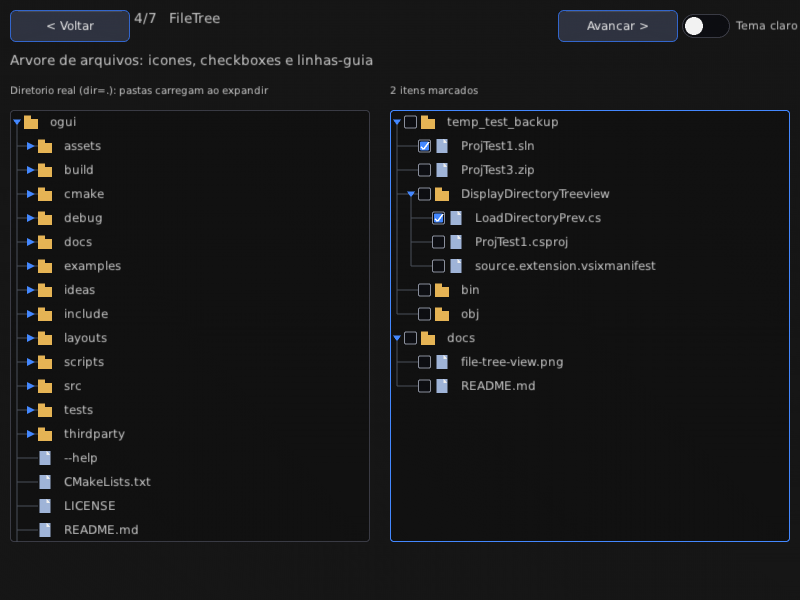

# ogui

GUIs for OpenGL applications, described in XML.

ogui is a small retained-mode UI library: you author a screen as an XML
document, ogui turns it into a widget tree, feeds your mouse/keyboard into
it, and hands you back a `DrawList` of 2D geometry. Rendering happens either
into a window owned by your host (`Kernel` + `GlBackend`) or one the library
creates for you (`ogui::Host`, a built-in Win32/WGL window and event loop).

* **XML layouts** — `<window>`, `<column>`, `<button>`, `<tabs>`, ... with
  named styles, authored in a text editor and hot-reloaded by re-parsing.
* **Reusable components** — `<template name="Card">` declares markup that
  becomes an element: parameters with defaults, `${name}` substitution,
  `<slot/>` content areas, ids scoped to the instance (`card.title`, nesting
  with the component that owns them) and a root that hears its own events, so a
  screen composes instead of repeating itself
  (see [`docs/xml-reference.md`](docs/xml-reference.md#templates-components)).
* **Input dispatch** — hover, capture (drag), focus, key routing, modifiers,
  click bindings, hover tooltips.
* **Visual states** — declarative `hover:`/`pressed:`/`focus:`/`checked:`/
  `selected:`/`disabled:` overlays on colors, border width and radius, with
  optional `transition="0.2"` blending — no script required.
* **Text** — UTF-8 end to end: atlas glyphs, word wrap, caret + selection,
  horizontal scrolling of long lines, clipboard integration.
* **Two renderers for one DrawList** — `GlBackend` (OpenGL 3.3 core or
  OpenGL ES 3.0, picked from the running context, every entry point resolved
  at runtime, so the library never links against GL) and `SoftwareRenderer`
  (pure CPU, for headless tests and screenshots).
* **Scripting** — screens embed Lua 5.4 chunks (`<script>`); the engine
  owns the loop and calls the script's `ogui_on_load`/`ogui_on_show`/`ogui_on_update`/`ogui_on_click`/
  `ogui_on_event` hooks through the `ogui` API table: widget attributes,
  input queries (`mouse`/`key`/`mods`), focus/hover, list content
  (full `items` or incremental `ogui.list` insert/remove/set),
  `ogui.prop` reads/writes `propertygrid` models by name,
  `ogui.cmd` drives `commandpalette` models and histories,
  engine-driven `tween` animations, `after`/`every` timers, dynamic
  widget creation (`add`/`remove`/`clear`), tree navigation
  (`children`/`parent`/`index`), per-widget event
  listeners (`ogui.on`/`ogui.off`) on typed events that bubble to the
  ancestors (`click`/`change`/`submit`/`focus`/`blur`,
  see [`docs/events.md`](docs/events.md)), declarative data bindings
  (`ogui.bind`/`ogui.unbind`) and inspection
  (`ogui.dump`/`inspect`/`debug`/`stats`).
* **Debug tools** — a text dump of the widget tree, per-widget inspection and
  a draw-list overlay (bounds, labels, focus order, hover) plus frame timing
  and an opt-in event log; the same hooks from C++ and Lua, and
  `ogui_screenshot --debug` renders them headlessly.
* **Extendable** — `widgetRegistry()` maps an element name to a factory that
  receives the authored attributes, so a custom `Widget` subclass becomes a
  first-class element; unknown elements are reported with line:col instead of
  throwing.
* **Typed events that travel** — `click`, `change`, `submit`, `focus` and `blur`
  carry a target, a source and a point, and are routed from the widget they
  happen to up through its ancestors, so one container listener watches what is
  inside it; `stopPropagation` (C++) or `return false` (Lua) ends the route
  (see [`docs/events.md`](docs/events.md)).
* **Widgets addressed by id** — `Kernel::findWidget` and the Lua id lookups hit
  an `id → widget` index the kernel rebuilds once after each change to the tree
  (add, remove, rename, screen switch), so a script that resolves dozens of ids
  every frame pays one walk of the tree per change instead of one per lookup;
  values are weak, so an id whose widget is gone comes back as `nullptr` rather
  than a dangling pointer.
* **One catalogue of properties** — every attribute a class answers to by name is
  declared once, typed and with a read/write pair (`PropertyRegistry`), so
  `Widget::setProperty`, `ogui.get`/`ogui.set` and `ogui.props` share one
  validator instead of each keeping its own ladder of casts; a bad value comes
  back as a message naming what it expected, and a host widget declares its own
  properties into the same registry (see
  [`docs/xml-reference.md`](docs/xml-reference.md#typed-properties)).
* **Unicode text** — UTF-8 everywhere, glyphs rasterized on demand into
  reserved atlas cells, a fallback chain across faces for scripts the
  requested family does not carry, a visible `.notdef` box for the ones
  nothing has, cluster-wise caret and line breaking that handles CJK
  (see [`docs/unicode.md`](docs/unicode.md)).
* **Documented and tested** — [`docs/xml-reference.md`](docs/xml-reference.md)
  catalogues every element, attribute and default; [`docs/examples.md`](docs/examples.md)
  walks through minimal XML, Lua behaviour and custom widgets, and `ctest`
  executes both the shipped examples and every snippet in those docs.
* **Static library, few dependencies** — stb and Lua are vendored; the
  parser is a hand-rolled tokenizer with no third-party code.

## Requirements

* C++20 compiler (GCC 10+, Clang 12+, MSVC 2022), CMake 3.16+
* A system font (DejaVu, Liberation, ...). ogui looks in the usual
  directories for `sans` / `serif` / `mono`; see [Fonts](#fonts).
* For the demo: OpenGL 3.3 core or OpenGL ES 3.0 (WGL on Windows, GLX/EGL
  elsewhere). The `gl` test needs EGL plus `libGLESv2` to build; without them
  it is skipped, not failed.

## Building

```sh
# Linux/macOS: configure, build, run the test suite and the headless demo
./scripts/build.sh

# Windows demo.exe cross-compiled with mingw (static, no DLL hell)
# -> written to debug/demo.exe together with the XML screens it loads
./scripts/build.sh win

# Remove build trees
./scripts/build.sh clean
```

`build.sh` is a thin wrapper over CMake; the raw equivalents are:

```sh
cmake -S . -B build -DOGUI_BUILD_EXAMPLES=ON -DOGUI_BUILD_TESTS=ON
cmake --build build -j
(cd build && ctest --output-on-failure)
```

On Windows with Visual Studio, `ogui.sln` / `ogui_demo.vcxproj` build the
Win32 + WGL demo directly (the project compiles the library sources itself).

### Options

| Option | Default | Effect |
| --- | --- | --- |
| `OGUI_BUILD_EXAMPLES` | `ON` | `ogui_demo`, `ogui_screenshot`, `ogui_demo_win32`, `ogui_validate`, `ogui_custom_widget` |
| `OGUI_BUILD_TESTS` | `ON` | unit tests + golden-image test |
| `OGUI_USE_STATIC_STB` | `ON` | build stb_truetype/stb_image from `thirdparty/stb` |
| `OGUI_USE_LUA` | `ON` | embed the vendored Lua 5.4 (`thirdparty/lua`) for `<script>` screens |

## Tests

```sh
cd build && ctest --output-on-failure   # parser, drawlist, validate, validate-bad,
                                        # custom-widget, kernel, unicode, screens,
                                        # scrollbar, script, properties, templates,
                                        # examples, golden, gl, touch
```

* `parser` — XML tokenizer, attributes, styles, error reporting.
* `drawlist` — rasterizer geometry, text measurement and wrapping.
* `validate` — `ogui_validate --manifest` over every screen in `manifest.xml`:
  the shipped layouts must parse with zero errors.
* `validate-bad` — the same tool on `debug/tests/bad_layout.xml` must exit 1 and
  report the unknown element with its line:col.
* `custom-widget` — registers a `<led>` element through `widgetRegistry()` and
  drives it through a real `Kernel` frame (tick, draw, dump, tab order, click).
* `kernel` — input dispatch, focus/capture, text editing, tabs, tooltip, the
  id index (add, re-parent, remove, rename and screen switch all re-index,
  duplicate ids resolve to the first in document order), and event propagation:
  the walk reaches each ancestor in order, `stopPropagation` cuts it, raw wheel
  input never bubbles, and a handler may remove the widget the event is about
  mid-walk.
* `touch` — the finger list folded into the kernel's pointer: a tap is a click
  at logical coordinates whatever the screen scale, a drag keeps its capture
  past the widget's edge and does not click when released elsewhere, a second
  finger cannot steal the press and the drag survives the owning finger
  lifting, `touchCancelled` releases without clicking, no widget is left
  hovered after the last finger leaves, the mouse takes the pointer back when
  it moves on a machine that has both, and a mouse-only host behaves exactly
  as before. Also the gestures folded onto the same pointer: the slop before a
  drag becomes a pan, the scrollable widget that claims it — the pressed one
  first, then its ancestors — takes the capture away without clicking, the
  content tracks the finger in its own `scrollUnit()` steps, a thumb drag or a
  text selection vetoes, a flick keeps scrolling and settles, a slow release
  leaves no inertia, and a new finger stops a scroll in flight.
* `unicode` — on-demand glyph baking (a late glyph never moves an early one),
  the fallback chain between faces, the `.notdef` placeholder, zero-advance
  combining marks, CJK line breaking with no stranded closing punctuation, and
  real Cyrillic ink reaching the framebuffer.
* `screens` — every manifest screen parses in both themes and keeps the ids the gallery binds to.
* `scrollbar` — presses on the listbox/treeview/table/scrollview/window/textarea bars scroll instead of selecting or hitting children; dropdown popups fit the screen and scroll.
* `script` — `<script>` collection, screen-bound Lua loading on screen
  switches, all four hooks and the `ogui.*` widget API; error capture. Covers
  the bubbled `info` table, a container listener hearing its children, and
  `return false` stopping the walk.
* `properties` — the typed property registry: base chains and per-class
  overrides, host classes declaring their own, a write/read round-trip over
  every one of the 1975 built-in properties that read and write, a walk of the
  tag factory refusing any widget that reaches runtime without a table,
  per-type value validation with its error text, and the Lua
  `ogui.get`/`ogui.set` fallback plus `ogui.props`.
* `templates` — reusable components: parameter defaults and instance
  overrides, `<slot/>` with fallback markup, id scopes that nest with the
  components that own them, attribute and style fall-through to the generated
  root, composition (a component inside a component inside a slot), per-instance
  scripts, the recursion/depth guards and every error message naming the
  component an author actually wrote — plus a component driven through a real
  `Kernel` frame and one added at runtime by `ogui.add`.
* `examples` — runs `examples/hello.xml` and `examples/counter.xml` through a
  real `Kernel` (load/show hooks, a clicked button, a live binding) and then
  parses every fenced `xml`/`lua` block in `docs/examples.md`, so the docs
  cannot rot into snippets that no longer work.
* `golden` — renders a fixed `@token` layout through
  `Kernel -> DrawList -> SoftwareRenderer` in both themes and diffs it
  against `debug/tests/golden/basic.png` (dark) and `debug/tests/golden/basic_light.png`
  (4/4/4 channel slack, 1% bad pixels allowed for FP rounding; it **skips**
  instead of failing when the resolved font files differ from the ones
  recorded in the matching `.meta`).
* `gl` — renders the same scene (the layout `golden` uses, shared through
  `debug/tests/golden_scene.hpp`) through `GlBackend` in a real GL context and
  diffs it against the `SoftwareRenderer` frame. It creates two contexts over
  EGL — an ES one with `EGL_CONTEXT_CLIENT_VERSION=3` and a desktop one — so
  both shader dialects, `Profile::Auto` detection and the GLES-only paths
  (sized `GL_RGBA8`, per-component texture swizzles) are actually executed, and
  asserts that `render()` restores the GL state it touched and that a second
  frame is bit-identical. The pixel assertion tolerates a one-pixel radius,
  because `SoftwareRenderer` treats every triangle edge as covered while GL
  applies the top-left rule; a shape in the wrong place or a colour off by more
  than that still fails. It **skips** where EGL or `libGLESv2` are missing, and
  where no context can be created (a machine with no software rasterizer).

Regenerate the golden after an intentional visual change:

```sh
OGUI_UPDATE_GOLDEN=1 ./build/ogui_golden_test
```

## Quick start

```cpp
#include "ogui/kernel.hpp"
#include "ogui/xmlparser.hpp"
#include "ogui/glbackend.hpp"

// 1. Layout -> widget tree
ogui::XmlParser parser;
auto res = parser.parseFile("ui.xml");
if (!res.root) { /* res.errors holds "line:col: message" */ }

auto screen = std::make_shared<ogui::Screen>("main");
screen->widgets.push_back(res.root);
screen->width  = 1280.f;
screen->height = 720.f;

// 2. Kernel
ogui::Kernel kernel;
kernel.init();
kernel.pushScreen(screen);
kernel.bind("onStart", []{ /* fired when a widget with onClick="onStart" is clicked */ });

// 3. GL backend (after your context is current)
ogui::GlBackend backend;
if (!backend.init(/*getProc=*/nullptr)) { /* backend.lastError() */ }

// 4. Every frame
ogui::InputState in;              // fill from your window proc
in.mouseX = ...; in.mouseY = ...;  in.mouseDown[0] = ...;
in.keyDown[...] = ...; in.lastChar = ...;  in.time = ...;  // seconds
                                   // mouse coords are device pixels; the
                                   // kernel divides by screen->scale
kernel.frame(in);                 // events -> layout -> DrawList
backend.render(kernel.drawList(), fbWidth, fbHeight, /*flipY=*/false);
// swap your buffers
```

Or let the library own the window entirely (`ogui::Host`, currently Win32/WGL):

```cpp
#include "ogui/host.hpp"

ogui::Host host({.title = "ogui demo", .width = 800, .height = 600});
if (!host.open()) { /* host.lastError() */ }
host.run(kernel);   // owns input, resize, rendering and the event loop
```

`examples/demo.cpp` is this loop without a window (it prints what would be
rendered). `examples/demo_win32.cpp` shows the shortest path: `ogui::Host`
creates the Win32 window, the WGL context and the frame loop, so the demo is
just layout + handlers + `host.run(kernel)`. The host is DPI-aware
(per-monitor with a system fallback), honours `keyRepeat` for held keys, and
adds a few conveniences you opt into:

* `Settings::fullscreen` / `toggleFullscreen()` (and `F11` inside
  `run()`) — borderless fullscreen that restores the windowed placement.
* `Settings::iconPath` — an `.ico` loaded as the window icon.
* `setOnFilesDropped(...)` — Win32 drag & drop, paths arrive as UTF-8.
* system clipboard handlers installed automatically.
* the window lives in the normal Z-order band (not topmost), so it can be
  covered when minimised and never blocks taskbar apps while maximised;
  `F11` fullscreen is likewise a top *normal* window, not a topmost one.

`examples/screenshot.cpp` renders the same layout to a PNG with no GL at all.

The Win32 demo (`examples/demo_win32.cpp`) is a **gallery**: the available
widgets are grouped across several screens, all loaded into one `demo.exe`.
Which screens exist is **data, not code**: `manifest.xml` in the working
directory lists them in navigation order —

```xml
<manifest theme="dark">
  <screen title="Basico" path="layout_demo.xml"/>
  <screen title="Texto"  path="layouts/layout_text.xml"/>
  ...
</manifest>
```

— so adding or removing a screen needs no recompile (a built-in list is the
fallback when the file is missing). `theme="dark|light"` (`escuro`/`claro`
also accepted) picks the initial palette — or name a `<theme>` stylesheet
file (e.g. `theme="themes/game.xml"`) to layer custom tokens, named styles
and fonts over dark; the nav bar toggle still flips the preset at runtime.
`examples/gallery.hpp` parses it with the
library's own `XmlParser` (`<manifest>` is a data-only root tag; every widget
keeps the attributes it was authored with in `Widget::rawAttributes()`),
injects a shared `< Voltar` / `Avancar >` nav bar (plus a `Tema claro`
switch that flips `darkTheme()`/`lightTheme()` and re-parses every screen)
into each root and swaps
screens with `Kernel::switchScreen` (bindings key off widget ids, so the nav
works on every screen). `ogui_screenshot out.png W H [screenIndex] [light]`
renders any one of those screens headless, optionally with the light theme.

## Animations

`Widget::animateTo(target, duration, ease)` tweens bounds over the input
clock; `animateTo` calls stack smoothly (a new call snaps the in-flight tween
and animates from the current bounds). Combo box popups use it for their fade
open. `TweenEase` (linear, in/out cubic, ...) lives in `tween.hpp`.

## Visual states

Interactive widgets draw hover / pressed / focus feedback from
`Widget::isHovered()` / `isFocused()` (and `Kernel::mousePos()` for per-region
effects): buttons brighten on hover and darken on press with a faint top
highlight, checkboxes/radios tint their box, slider and range-slider thumbs
grow and round while grabbed, spinbox buttons highlight individually, combobox
borders accent and the arrow flips while open, and text inputs/spinboxes get a
2px accent focus ring. `shade()` / `withAlpha()` in `api.hpp` build the tints.

## XML reference

The complete element/attribute catalogue — every registered tag, its typed
attributes, `@token` palette values for both themes and the named-style
rules — lives in [`docs/xml-reference.md`](docs/xml-reference.md). Quick
intro below.

Attribute names are full camelCase (`background`, `width`, `height`,
`rowHeight`, `borderWidth`, `fontSize`, `onClick`, …) and matching is
case-insensitive (`rowHeight` ≡ `rowheight` ≡ `ROWHEIGHT`). The old
single-word abbreviations (`bg`, `w`, `h`, `cols`, `src`, `theight`, `panelw`,
`panelh`, `headerbg`) are not recognised — use the full spelling.
Conventional names that are not abbreviations stay as-is: `x`, `y`, `id`,
`min`, `max`, `color`, `text`, `value`, `label`, `title`.

```xml
<screen id="main">
  <style name="primary" background="#4488ff" color="#ffffff" radius="6"/>

  <window id="win" x="120" y="80" width="560" height="420" title="ogui demo"
          background="#202020" border="#4488ff" borderWidth="1">
    <column id="col">
      <button id="start" style="primary" text="Iniciar"
              x="20" y="20" width="200" height="44" onClick="onStart"
              tooltip="Iniciar a simulacao"/>
      <textinput id="log" x="20" y="80" width="520" height="40" placeholder="..."/>
      <tabs x="20" y="140" width="520" height="120" tabHeight="26" active="0">
        <tab label="Geral">
          <label text="conteudo" x="12" y="8" width="400" height="22"/>
        </tab>
        <tab label="Avancado">
          <label text="ajustes" x="12" y="8" width="400" height="22"/>
        </tab>
      </tabs>
    </column>
  </window>
</screen>
```

### Common attributes (every element)

| Attribute | Meaning |
| --- | --- |
| `id` | lookup key for `Kernel::findWidget/setText/getText` and `bind()` |
| `onClick` / `bind` | binding name resolved on click against `Kernel::bind` |
| `tooltip` | text shown by the hover tooltip after ~0.5 s |
| `x` `y` `width` `height` | bounds, **relative to the parent**, in logical units (see [DPI](#dpi-scale-and-logical-units)); each accepts a plain number (`20`), percent (`"50%"`) or — for `width`/`height` — `"fill"` (see below) |
| `anchor` | pin edges across parent resizes: `anchor="right"`, `"l,r"`, `"top,bottom"` etc. (`left/right/top/bottom`, short forms `l/r/t/b`, space/comma-separated) |
| `minWidth` `minHeight` `maxWidth` `maxHeight` | pixel clamp on the resolved size, applied on every layout pass whatever unit `width`/`height` used (`"50%"` + `maxWidth="500"` grows up to 500 px; `"10%"` + `minWidth="200"` never shrinks below) |
| `weight` | flex share inside a `column` (leftover height) or `row` (leftover width), proportionally to the other weighted children; 0 keeps the authored size |
| `visible` | `true/false` — an invisible widget (and its subtree) is skipped by drawing *and* input |
| `style` | named style(s) applied to the element; a comma/space list stacks (`"a,b"`, later wins) |
| `background` `color` `border` `borderColor` `borderWidth` `radius` | colors/metrics |
| `enabled` / `disabled` | `false`/`true` — an inert widget takes no hover/press/focus and is skipped by hit-testing (subtree included) |
| `hover:background` `pressed:color` `focus:border` `disabled:*` `checked:*` `selected:*` | per-state visual overlays; the plain attribute is the `normal` base, priority `disabled > pressed > hover > selected > checked > focus` (see `docs/xml-reference.md`) |
| `transition` | seconds to blend visual-state changes (linear, interruptible) |
| `shadow` | soft drop shadow: `blur` or `blur,dy` or `blur,dx,dy` (pixels) |
| `shadowColor` | shadow color (default `#000000`), e.g. `shadowColor="#000000"` |
| `gradient` | vertical background gradient end color: `background` stays the top color; `gradientDirection="horizontal"` ramps left→right instead |
| `padding` `margin` | layout knobs (`<column>` uses both) |
| `gap` | `column`/`row` child spacing in px (falls back to `margin`, then the default 4) |
| `font` `fontSize` | `font="sans 20"` or the legacy `font sans 20 color "#66ee66"` |

### Theme & palette

Widget chrome resolves through a `Palette` token set (surface, border, text,
accent, …) instead of fixed colors: pass a `Theme` to `XmlParser::parse/parseFile`
and it becomes the active theme (`ogui::setActiveTheme`), so the whole tree —
including tooltips, toasts and popups — picks up the new look. The theme's
`defaultStyle` seeds every widget before its own attributes are applied.

Any colour attribute also accepts `@token` instead of a hex literal — the
token is resolved against the active palette at parse time:

```xml
<panel id="bg" x="0" y="0" width="100%" height="100%" background="@screen"/>
<label text="Title" color="@textBright"/>
```

Tokens: `window screen surface surfaceHi surfaceLo border borderStrong track
guide text textBright white dim focus accent danger info warn error overlay
shadow` (case-insensitive; unknown names fall back to `window`).

Two presets ship with the library: `ogui::darkTheme()` (the default palette)
and `ogui::lightTheme()`. Because `@tokens` and widget defaults are resolved
while parsing, switching themes at runtime means re-installing the preset and
re-parsing the layouts; the demo's nav bar does exactly that with its
"Tema claro" toggle (binding `navTheme`).

### Relative geometry (resize / maximize)

Percent and fill components are re-resolved on every layout pass against
the parent's content area (the screen for top-level widgets, the inner
area below the title bar inside a `<window>`, the content width inside a
`<column>`), so resizing or maximizing the window reflows the tree:

```xml
<panel id="bg" x="0" y="0" width="100%" height="100%" background="#161616"/>
<slider  id="sl" x="1.25%" y="292" width="92.5%" height="20"/>
```

Absolute components keep whatever the bounds currently hold, so runtime
moves (window dragging, splitter panes) survive untouched. A widget with
no percent/fill components behaves exactly as before.

`minWidth`/`minHeight`/`maxWidth`/`maxHeight` clamp the resolved size in
pixels on every layout pass, independent of the unit `width`/`height` were
authored in:

```xml
<!-- grows with the parent, capped at 500px; never below 200px -->
<panel id="card" x="0" y="0" width="50%" height="80" minWidth="200" maxWidth="500"/>
```

Authored absolute sizes are clamped at parse time too.

### Anchors

`anchor` pins the distance between a widget edge and the parent's
matching edge. The margins are captured on the first layout pass (after
percent/fill resolution, so the authored units don't matter) and held for
the rest of the session:

```xml
<!-- stays 20px from the navbar's right edge, 120px wide -->
<button id="exit" x="700" y="6" width="120" height="20" anchor="top,right"/>
<!-- stretches with the parent, keeping a 10px gap on each side -->
<panel id="band" x="10" y="100" width="620" height="40" anchor="l,r"/>
```

Anchoring both edges of an axis keeps both margins and stretches the
widget between them (the anchored size replaces any percent/`fill`
component on that axis). Anchoring a single edge moves the widget so that
edge's margin is preserved, while its size keeps following its own spec.
Axes without anchor bits behave exactly as plain relative geometry.

Element-specific attributes win over the named style, which wins over the
theme default.

### Elements

| Tag | Purpose | Extra attributes |
| --- | --- | --- |
| `screen` | document root (one per file) | — |
| `manifest` | data-only root listing gallery screens (`<screen title path/>` children) | `theme` (`dark`/`light`, initial palette) |
| `style` | named style definition (`name`) or element-wide defaults (`element="button"`) applied under own attributes and named styles | `name` / `element` |
| `default` | inside `<theme>` only: base Style overrides (`font`, `fontSize`, `color`, `background`, ...) | — |
| `font` | registers a font family for later `font="..."` use (data-only, no widget) | `family`, `source` (TTF/OTF path) |
| `theme` | stylesheet root: shared palette + named styles + fonts (`base="dark\|light"` preset it layers over) | `name`, `base` |
| `palette` | inside `<theme>` only: re-colours tokens (`accent="#e8b33c" ...`); unknown tokens warn | token names |
| `stylesheet` | merges an external `<theme>` file into the current document (named styles, fonts, palette) | `path` |
| `template` | declares a reusable component whose `name` becomes an element (data-only, no widget of its own): `${param}` substitution, `<slot/>` for the instance's children, ids scoped to the instance | `name`, then one attribute per parameter default |
| `script` | Lua chunk for the screen — `<script src="file.lua"/>` or inline `<script>code</script>`; hooks `ogui_on_load`/`ogui_on_update`/`ogui_on_click`/`ogui_on_event` + `ogui` API (see [xml-reference](docs/xml-reference.md)) | `src` |
| `panel` | plain rectangle container | — |
| `window` | bordered panel with a title bar (children are offset by it) | `title`, `titleVisible` |
| `column` | stacks children vertically (gap 4 or `gap`, honours `padding`/`margin`); stretches to the parent's width | `gap`, `align` (`center`/`right` place children horizontally, `left` keeps the authored x), `weight` on children (split leftover height) |
| `row` | lays children out horizontally, tiling authored widths with a gap | `gap`, `valign` (`middle`/`bottom` place shorter children against the tallest), `wrap` (`true`: children past the row width flow to a new line, growing the height), `weight` on children (split leftover width when the row has an authored width or room from its parent) |
| `grid` | row-major tiling over column tracks; children fill each cell origin (child `x`/`y` are ignored, percent/fill resolve against the cell) | `columns` (`"3"` = 3 equal tracks, or a list like `"120 1fr 25%"`: px, fractional, percent), `gap` (px, default 4), `rowHeight` (px; default is auto = tallest child of the row) |
| `label` | text | `text`, `wrap`, `align="left\|center\|right"` |
| `button` | clickable button, press/release feedback | `text`, `align="left\|center\|right"`, `textPadding` (inset for left/right) |
| `textinput` | single-line UTF-8 editor: caret, click-drag / Shift+arrows / Shift+click selection, double-click selects the word, triple-click selects all, Ctrl+Left/Right jump words, Ctrl+A/C/X/V | `text`, `placeholder` |
| `textarea` | multiline UTF-8 editor: Enter inserts a newline, Up/Down navigate lines, selection spans lines (word/line drag, double/triple-click and Shift+click like `textinput`), long lines soft-wrap to the widget width, wheel scrolls, vertical scrollbar (drag the thumb or click the track) when content overflows | `text`, `placeholder` (style attrs as `textinput`) |
| `listbox` / `virtuallist` | scrollable list with single selection (click, wheel, Up/Down/Home/End); rows are drawn from a string model so large lists stay cheap — `virtuallist` is the same widget, and `ogui.list` inserts/removes/changes rows incrementally | `selected`, `rowHeight`, `highlight` + `<item>` children |
| `console` | read-only log view mirroring `Kernel::logs()` — newest line on top, wheel scrolls history, error/script lines tinted red | `rowHeight`, `maxLines` (default 200) |
| `item` | a `listbox` entry | `label` / `text`, `value` |
| `propertygrid` | two-column typed property editor: label left, kind-appropriate editor right (bool → checkbox, number/text/color → inline edit, enum → click-cycle select). Group headers where `category` changes; click/Up/Down select, Enter/F2 edit, Space toggles bools, Left/Right cycle enums, Esc cancels. Wheel scrolls; overlay scrollbar on overflow | `rowHeight`, `color`, `labelColor`, `groupColor`, `highlight`, `background`, `borderColor` + `<property>` children |
| `property` | a `propertygrid` row (data only): `name`/`label`, `type` (`bool`/`number`/`text`/`enum`/`color`), `value`, `category`/`group`, `options="a;b;c"` (enum), `readonly` | — |
| `table` | data grid: header click sorts (re-click flips direction), row click selects, wheel + Up/Down/Home/End; drag a header edge to resize a `resizable` column, click a cell in an `editable` column (or press F2) to edit it inline (Enter saves, Esc cancels), overflowing cell text marquees per `scrollingText` | `selected`, `rowHeight`, `headerHeight`, `sortable`, `headerBackground`, `highlight` + `<th>`/`<tr>` children |
| `th` | a `table` column | `label` / `text`, `width` (0 = share leftover width), `resizable`, `editable`, `scrollingText` (`automatic` / `onmouseenter`) |
| `tr` | a `table` row: cells from `cells="a;b"` or nested `<cell>` children | `cells` (`;`-separated), `value`, `editableCells` (`;`-separated column labels), `resizable`, `scrollingText` |
| `cell` | a `tr` cell written as an element (`<cell>text</cell>`) | text content; `editable`, `resizable`, `scrollingText` (override the column) |
| `tree` | hierarchical tree: triangle toggles expansion (rows compress/slide instead of blinking away), click selects, Left/Right collapse/expand; auto-shrinks to its visible rows when collapsed. `icons`/`checks`/`guides` turn it into a file-tree view (folder/file glyphs, a per-node checkbox that fires the widget `bind()`, and dotted parent connectors). With `dir`, the tree mirrors a real filesystem folder: children are read lazily on first expand (dotfiles hidden, dirs first), `<treeitem>` children are ignored | `selected`, `rowHeight`, `indent`, `autoHeight` (default true), `accent`, `highlight`, `icons`, `checks`, `guides`, `dir` + nested `<treeitem>` children |
| `treeitem` | a `tree` node (may nest further `<treeitem>`s) | `label` / `text`, `value`, `expanded`, `folder`/`file`, `checked` |
| `treetable` | tree hierarchy inside tabular columns: column 0 shows a triangle + the indented node label, the remaining columns show each node's `cells`. Click a header to sort siblings at every level (re-click flips direction), click a row to select it, wheel + Up/Down/Home/End scroll, Left/Right/Enter/Space collapse/expand. Only the viewport rows are drawn, so large trees stay cheap | `selected`, `rowHeight`, `headerHeight`, `indent`, `sortable`, `expanded` (true = expand all), `headerBackground`, `highlight`, `accent` + `<th>`/`<tnode>` children |
| `tnode` | a `treetable` row (data only; nests further `<tnode>`s) | `label` / `text` (column 0), `cells="a;b;c"` (columns 1..n), `expanded` |
| `statusbar` | flat text band with a hairline separator on top, sized for the foot of a window or panel | `left` (or `text`), `center`, `right`, `color`, `dimcolor` (right text), `background`, `size` |
| `breadcrumb` | clickable path segments joined by a separator: clicking sets the active segment, fires the widget `bind()` and any `onSelected` callback; segments come from a `path` string or nested `<crumb>` children | `path="a/b/c"`, `separator` (default `/`), `current` (index, omitted = last), `color`, `dimcolor`, `accent` (separator), `size` + `<crumb>` children |
| `crumb` | a `breadcrumb` segment (data only) | `label` / `text` |
| `keybind` | shortcut capture box: click or keypress arms capture, a modifier+key combo records the binding (`change` fires), Backspace/Delete clears, Esc cancels; combos are validated `ctrl+alt+shift+super+x` strings | `value`, `placeholder`, `color`, `background`, `bordercolor`/`border` (focus/capture tint), `radius`, `size` |
| `commandpalette` | incremental-search launcher over registered commands: type to filter (name matches rank above hint matches), Up/Down/Home/End walk the matches, Enter or a click runs the selection (`change`) and lands in a deduplicated newest-first history, Esc fires `submit` so the host can close it | `query`/`filter`, `placeholder`, `maxHistory`, `rowHeight`, `headerHeight`, `color`, `dimcolor`, `accent`, `highlight`, `background`, `size` + `<cmd>` children |
| `cmd` | a `commandpalette` entry (data only) | `name` / `label` / `text`, `hint` / `desc`, `key` / `shortcut` |
| `toggleswitch` / `toggle` | compact pill switch for a binary mode: click slides the knob over an accent-tinted track, firing `onChanged(bool)` and the widget `bind()` | `checked`/`on`, `text` (trailing label) |
| `checkbox` | toggle + label | `text`, `checked` |
| `radiobutton` | radio toggle in group | `text`, `checked`, `group` |
| `combobox` | dropdown: current value shown, popup lists `<option>` children (keyboard Up/Down/Enter, autoclose on outside press) | `selected` (index or `label=`), `rowHeight`, `panel` (popup bg), `highlight`, `highlighttext`, `arrow` |
| `slider` | value in `min..max` (drag, arrows, Home/End) | `min`, `max`, `value`, `color` (bar), `background` (track), `thumbColor` |
| `spinbox` | numeric value with `-`/`+` buttons on each end, drawn as one unified widget (flat button regions + hairline separators); focused Up/Right/Down/Left step, Home/End clamp | `min`, `max`, `value`, `step`, `decimals`, `wrap` (cycles min↔max), `prefix`, `suffix` (or `text`), `background`, `color` (text), `buttonColor`, `borderColor`/`border`, `font` |
| `optionspin` | text-only spin `[ < ][ option ][ > ]`: cycles through a fixed list of options as one unified widget; focused Right/Up forward, Left/Down back, Home/End first/last | `options` (comma-separated list), `value` (matching option text) or `index`, `wrap` (default true), `background`, `color`, `buttonColor`, `borderColor`/`border`, `font` |
| `rangeslider` | two-thumb slider over a `[low, high]` sub-range; drag the nearest thumb (the band between is filled), focused Left/Right nudge low and Up/Down nudge high | `min`, `max`, `low`, `high`, `color` (band), `background` (track), `thumbColor` |
| `splitter` | two panes (first two children, placed in the splitter's own space) with a draggable divider kept at a `split` fraction; the panes resize as the handle is dragged | `orientation` (`"vertical"` = vertical divider/side-by-side panes (default), `"horizontal"` = stacked panes) or `vertical` (bool), `split` (0..1), `handleSize`, `handleColor` |
| `progress` | read-only fill; `indeterminate="true"` slides a block back and forth instead of showing a value | `value` (0..1), `indeterminate`, `color`, `background`, `radius` |
| `badge` | small pill tag (rounded to a capsule); `removable` adds an ✕ hit-region at the right that hides the badge when clicked; `count` appends `(n)` | `text`, `count` (-1 = none), `removable`, `background`, `color` (text), `border` |
| `spinner` | animated loading indicator ticked by the frame clock: `variant="glyph"` cycles &#124;/-\, `variant="blocks"` runs a comet of cells; optional trailing label | `text`, `variant` (`glyph`/`blocks`), `speed`, `color` |
| `searchinput` | `textinput` with a magnifier icon inset on the left and a ✕ clear button on the right (click clears the text) | `text`, `placeholder`, `background` |
| `accordion` / `section` | stack of collapsible sections: clicking a section header toggles it; with `exclusive` (default) opening one closes its siblings; collapsed sections hide their children | `exclusive`, `gap` / `header`, `expanded`, `headerHeight` |
| `modal` | full-screen dim + centred panel that blocks all input below while open; children are laid out relative to the panel origin | `title`, `open`, `panelWidth`, `panelHeight` (toggle with `Modal::setOpen`) |
| `sparkline` | mini line plot of a value history (scaled to min/max); `addSample(v)` from C++ pushes a point and trims to `max` samples | `values` (`;`-separated), `label`, `max`, `color`, `background` |
| `menubar` / `menu` | menu bar strip; each top-level `menu` opens a floating popup under its label, commands route to `Kernel::bind()` | — / `label` |
| `menuitem` | a menu entry (nest more `menuitem`s inside it for a ▶ submenu) | `label` / `text`, `command` (a `bind()` name) |
| `menuseparator` | divider line inside a menu | — |
| `contextmenu` | right-click menu holder (invisible in the tree); any widget points at it with `contextMenu="<id>"` and right-clicking it opens the menu at the pointer (right-click never fires click bindings) | `id`; children are `menuitem`/`menuseparator` |
| `colorpicker` | swatch + hex label; click opens a popup with a saturation/value grid, a hue strip and a live hex readout; drags update the color and fire the widget's `bind()` | `color` (`#rrggbb`) |
| `pathpicker` | read-only path field with a `...` button that opens a file-browser popup (folders first with a trailing `/`, `..` to go up, capped at 40 entries); picking a file fires the widget's `bind()` | `value`, `placeholder`, `path` (start folder), `filter` (extension, e.g. `.png`) |
| `rampeditor` / `ramp` | horizontal color-gradient bar built from movable stops; click the bar to add a stop, drag a stop to reposition it, colours blend piecewise-linearly between neighbours; a change fires the widget's `bind()` | `stops` (`pos:#rrggbb pos:#rrggbb ...`, pos 0..1) |
| `curveeditor` / `curve` | cubic-Bézier curve in a unit box with four draggable control points (endpoints cyan, handles yellow); `evaluate(t)` samples the eased output for animation | `points` (`x,y x,y x,y x,y`, normalised 0..1, y up) |
| `separator` | rule, horizontal or vertical | `thickness`, `color` |
| `tabs` / `tab` | header strip over stacked pages (inactive pages take no input); pages that don't fit the width collapse into a `...` popup menu, or with `scrolling="true"` the header becomes a drag/wheel-scrollable strip that keeps every tab visible | `active`, `tabHeight`, `headerColor`, `tabColor`, `activeColor`, `accent`, `scrolling` / `label` |
| `group` | titled grouping box | `name` |
| `image` | RGBA image file (PNG/JPG/… decoded by `ImageManager` via stb_image): stretched to the bounds, or repeated at native size with `tile`; `border` draws a frame on top; a missing file draws nothing | `source` (path, relative to the working directory), `tile` |
| `scrollview` | wheel-scrollable clipped viewport over its children | `scrollX`, `scrollY`, `scrollStep` |

Toasts (transient notification banners) are a kernel layer rather than an
XML element: `Kernel::showToast("saved", Kernel::ToastKind::Info)` stacks a
banner bottom-right that fades out after ~3.5 s (`Info` / `Warn` / `Error`
pick the accent bar colour). `Modal` open state is driven from C++
(`Modal::setOpen`) or a `bind()` handler.

The gallery's **FileTree** screen (`layouts/layout_filetree.xml`) shows the
tree as a file browser: a `dir="."` tree mirroring the real folder next to a
static tree with per-node checkboxes feeding a `bind()` counter.



## Fonts

Text is rasterized into an atlas with stb_truetype and drawn as textured
quads. Families are resolved by `ogui::FontManager`:

```cpp
ogui::FontManager::instance().setFontPath("sans", "/path/to/font.ttf");
ogui::FontManager::instance().addSearchDir("/opt/fonts");
```

With no explicit mapping, ogui probes the well-known file names for
`sans` (default), `serif` and `mono` inside `/usr/share/fonts`,
`/usr/local/share/fonts`, `~/.fonts` (Windows: `%WINDIR%\Fonts`). A family
that cannot be found simply produces no text — tests report it instead of
crashing.

Per-frame texture upload is handled by `GlBackend::render()` via
`syncFonts()` and `syncImages()`; hosts normally never call them
themselves. Internally a font's atlas is a stable **negative** slot id
in the `DrawList` (`0` = white 1×1 fallback, `>0` = image slot handed
out by `ImageManager::load()` — or a texture id the host created with
`createTexture()`).

### Unicode

Text is UTF-8 end to end — XML attributes, Lua strings, `Widget::text()`.
The ranges above are baked when a face loads; anything else is rasterized
into reserved atlas cells the first time it is drawn (`Font::resolve()`), so
Cyrillic, Greek, Hebrew, Arabic, Thai and CJK reach real glyphs without
shipping a font per script.

A code point the requested family does not carry walks a fallback chain and
is baked into the first face that has it:

```cpp
auto& fm = ogui::FontManager::instance();
fm.setFontPath("noto cjk", "/usr/share/fonts/opentype/noto/NotoSansCJK-Regular.ttc");
fm.addFallback("noto cjk");      // default chain: sans, serif, mono
```

Cells never move, so a glyph baked late keeps the UV it had at start-up and
the CPU rasterizer can hold the atlas pointer it recorded once. When no face
carries a code point, one shared `.notdef` box is drawn at an em width —
missing text stays visible and keeps its measure instead of collapsing into
the space glyph. Combining marks advance nothing and are drawn over their
base, and the text widgets move the caret by cluster, so one Backspace
removes `e` + U+0301 as a single character.

`docs/unicode.md` documents the model, the line-breaking rules and the
HarfBuzz evaluation (no GSUB/GPOS shaping, no bidi: see Known limitations).

## Input details

`InputState` is a flat struct the host fills once per frame:

* `mouseX/mouseY`, `mouseDown[4]`, `mouseButton`, `scrollX/scrollY`
* `keyDown[256]` / `keyRepeat[256]` indexed by `ogui::KeyCode`
* `lastChar` — one UTF-8 code point per frame (host deduplicates)
* `time` — seconds since start; drives the tooltip delay
* `touches[]` / `touchCount` / `touchCancelled` — the fingers on the screen,
  each an `id` plus a device-pixel position, for a touch host

`Kernel::frame()` recomputes hover, delivers press/release with capture
(dragging keeps working outside the widget), routes characters to the focus
widget and key edges with `Mod_Shift/Ctrl/Alt/Super`. The host fills
`mouseX/mouseY` with **device pixels** (what the OS reports); the kernel
divides by the screen scale before anything reaches a widget, so widgets only
ever see logical units. `Widget::absoluteOrigin()` converts bounds.

A touch host fills `touches` instead of the mouse fields and the kernel folds
the list into the one pointer the tree already speaks (`Kernel::applyTouchStream`),
so no widget has to know a finger exists: a tap is a press and a release on the
widget under it, the finger that owns a drag keeps it — a second finger landing
elsewhere cannot steal the capture, and if the owner lifts while another stays
down the same press carries on — and `touchCancelled` (Android's
`ACTION_CANCEL`, a gesture the OS claimed) releases the widget without
clicking it. Once the last finger is gone the pointer leaves the tree entirely,
rather than leaving the widget under the last tap painted with its `hover:`
state. A host that reports both is handled by whoever moves last: the mouse
regains the pointer as soon as its fields change, and a finger takes it back
when one lands.

Past the kernel's 10-unit slop a finger stops being a press and becomes a pan
(`Kernel::updatePan`): the pressed widget is asked, then each of its ancestors,
and the first one that answers `wantsPan` with a non-zero `scrollUnit()` takes
the drag over — the widget holding the capture is released without being
clicked, and every later frame hands the finger's *pixel* displacement to that
widget's `onPointerScroll` in its own step units. So a finger scrolls exactly
what a wheel scrolls, with no new per-widget code, and the two rules that have
to stay separate do: a scrollbar thumb being dragged, or a text caret being
dragged through a selection, answers `wantsPan` with no and keeps its own drag.
Lift the finger mid-swipe and the velocity over its last tenth of a second
becomes a flick: `Kernel::advanceFling` decays it exponentially through the same
`onPointerScroll` until it stops, and putting a finger back down stops it. A
mouse drag is none of this — it is still a selection, a slider, a thumb.

`Tab`/`Shift+Tab` walk the focusable widgets of the current screen in
document order and wrap; `Kernel::focusNext(backwards)` exposes the same
movement and `Kernel::setFocusWidget()` / `Widget::isFocusable()` /
`accessibleName()` carry the exact target and the per-widget flags authors
set with `focusable` and `accessible`. `Enter`/`Space` activate a focused
`button` through `Kernel::clickWidget()` — the same path a mouse release
takes — while a `keybind` mid-capture keeps the keys for itself.

## Events and propagation

Five semantic events — `click`, `change`, `submit`, `focus`, `blur` — are typed
(`ogui::EventKind`) and carried by one `ogui::Event` that names its `target`,
the `currentTarget` being visited, the click `point` and its `source` (pointer
or keyboard). `Kernel::dispatchEvent` visits the widget the event happened to,
then each ancestor up to the screen root; at every stop the widget's C++
`Widget::onEvent` runs and its Lua listeners fire with `(id, info)`. A container
therefore watches its children with one listener, and `Event::stopPropagation()`
(C++) or `return false` (Lua) ends the walk.

Deliberately *not* propagated: raw mouse moves, wheel steps and key presses go
to the hit-tested or focused widget only, and `onclick` actions resolve against
the pressed widget alone. A scroll is offered to the nearest ancestor that can
actually scroll, which picks one receiver rather than broadcasting. Handlers may
remove the widget under the event — the kernel holds the chain, so the walk
finishes safely. [`docs/events.md`](docs/events.md) documents the tables and the
edge cases.

## DPI, scale and logical units

Every number a widget sees is in **logical units**: XML attributes,
`bounds()`, the pointer coordinates delivered to `onPointer*`, font sizes,
`Font::measure()` and the caret hit-testing built on it. `Screen::width` and
`Screen::height` stay **device pixels** — that is the host's truth, the
framebuffer it hands to `GlBackend::render()` — and `Screen::scale` says how
many device pixels one logical unit covers:

```cpp
screen->width  = 1600.0f;   // device px
screen->height = 900.0f;
screen->scale  = 2.0f;      // -> an 800x450 logical canvas
```

The logical→device multiply happens exactly once, where the `Rasterizer`
emits vertices and clip rects. Nothing else scales, so a value can never be
scaled twice, and a layout authored for 800x600 renders identically at scale
1. `Kernel` drives both sides per frame and exposes the result: `scale()`,
`setScale()`, `logicalWidth()`, `logicalHeight()`.

Text follows the same rule from the other end: `FontManager::setScale()`
bakes each atlas at `size * scale` device pixels while the `Font` accessors
keep reporting logical units, so glyphs stay crisp at any dpi and the numbers
used to hit-test a caret are the ones the widget drew with. Changing the
scale re-bakes the font cache.

A `scale` of 0, negative or NaN degrades to 1, so a host that never sets it
behaves exactly as before. `ogui::Host` (Win32) reads the window dpi every
frame and writes it into `Screen::scale`; a custom host does the same with
whatever its toolkit calls the content scale factor.

## Debugging and inspection

Development tools ride on the machinery that is already there: the widget tree
the parser built, the Tab order `focusNext()` walks, the draw list
`buildDrawList()` produces and the log `Console` mirrors. Nothing needs a live
GPU or a window — `examples/screenshot.cpp` renders every layer headlessly.

```cpp
kernel.setDebugOverlay(ogui::Kernel::DebugBounds | ogui::Kernel::DebugLabels |
                       ogui::Kernel::DebugFocus  | ogui::Kernel::DebugHover);
std::puts(kernel.dumpTree().c_str());   // whole tree, one line per widget
std::puts(ogui::Kernel::describe(kernel.focusedWidget()).c_str());  // "Button ok"
int stop = kernel.tabOrder(kernel.focusedWidget());   // -1 when not in the order

const auto& s = kernel.stats();   // updateMs, drawMs, widgets, tabStops,
                                  // vertices, indices, cmds
kernel.setDebugEvents(true);      // click / focus / binding -> Kernel::addLog
```

`dumpTree()` prints type, id, parent-relative bounds and absolute origin, then
the state flags (`hidden`, `disabled`, `focusable`, `focused`, `hovered`,
`pressed`), the `tab=` index and the `binding=`/`accessible=`/`tooltip=`
attributes. Types come from RTTI demangled once in `Kernel::typeName()`, so no
widget class has to carry a name. The overlay draws into the same `DrawList`,
so it is captured by screenshots and by the software renderer exactly like any
other quad.

From Lua the same four knobs are `ogui.dump()`, `ogui.inspect(id)`,
`ogui.debug(bits|"bounds labels focus hover all none")` and `ogui.stats()`.
The headless render is:

```sh
./build/ogui_screenshot dbg.png 900 640 1 --debug          # all layers
./build/ogui_screenshot dbg.png 900 640 1 --debug focus    # pick layers
```

What is not built yet: layout/clipping diagnostics — the overlay shows the
bounds a widget ended up with, but not *why* (which container rule or clip rect
produced them).

## Validating and documenting layouts

`ogui_validate` runs the parser over files without opening a window, so a text
editor or a CI step can lint a layout before it is ever rendered:

```sh
./build/ogui_validate layout_demo.xml
./build/ogui_validate manifest.xml --manifest --chdir .    # every screen in it
./build/ogui_validate themes/design.xml --theme            # a stylesheet
```

Output is `path: ok — N widgets, M scripts, K warning(s)` per file, then a
`validate: N error(s), M warning(s)` total; exit status is 0 clean, 1 on any
error, 2 on a usage or unreadable-file problem. `--theme` and `--manifest`
switch what the listed files are read as, and because
`<stylesheet path="..."/>` and `<script src="..."/>` resolve against the
working directory, `--chdir` has to point at the directory the app runs from.

The tutorials — smallest layout, a working counter, loading order and script
scopes, event/timer/binding snippets, a custom C++ widget, and what a mistake
looks like — live in [`docs/examples.md`](docs/examples.md). Every fenced block
there is executed by the `examples` test (`ctest -R examples`), as are the two
shipped files `examples/hello.xml` and `examples/counter.xml`;
`examples/custom_widget.cpp` is the same custom-widget path, self-tested.

## Clipboard

`Ctrl+C/X/V` in a `textinput` go through the process-wide
`ogui::Clipboard`. The default keeps the text in memory (fine for tests);
windowing hosts should install platform handlers:

```cpp
#include "ogui/clipboard.hpp"
ogui::Clipboard::instance().setHandlers(getFromSystem, putToSystem);
```

`examples/demo_win32.cpp` wires it to `CF_UNICODETEXT`.

## Consuming ogui

```cmake
find_package(ogui CONFIG REQUIRED)
target_link_libraries(myapp PRIVATE ogui::ogui)
```

Install it first (GNU layout, so any prefix works):

```sh
cmake --install build --prefix /usr/local
# or: cmake -DCMAKE_PREFIX_PATH=/opt/ogui ...
```

Alternatively add it to your build tree with `add_subdirectory(ogui)`.
The exported target carries the include path; stb stays an implementation
detail.

### Porting to OpenGL ES / Android

`GlBackend` runs on an ES 3.0 context: `init(getProc, profile)` takes
`Profile::Auto` (default), `Profile::DesktopGL` or `Profile::OpenGLES`, and
`Auto` reads `GL_VERSION`/`GL_SHADING_LANGUAGE_VERSION` from the context that is
already current, so the same binary works on either. The two dialects differ in
exactly three places, all handled inside the backend — the shaders are one body
with a `#version 300 es` or `#version 330 core` header (plus the `precision`
statement ES requires in a fragment shader), textures are created with the sized
`GL_RGBA8` internalformat that ES demands, and the alpha-only glyph atlas sets
its swizzle per component because the aggregate `GL_TEXTURE_SWIZZLE_RGBA` is
desktop-only.

The library links neither EGL nor GLES: `loadFunctions` resolves every entry
point through the `getProc` you pass, and with `getProc == nullptr` the default
resolver asks `opengl32.dll` and then `wglGetProcAddress` on Windows, `dlsym`s
the OpenGL framework on macOS, and on Android (`__ANDROID__`) tries
`libGLESv2.so` before falling back to `eglGetProcAddress` — never `libGL`, which
does not exist there. A host on any other platform just supplies its own loader:

```cpp
backend.init([](const char* name) { return myContextGetProcAddress(name); });
```

What is **not** there yet is the Android host. `ogui::Host` is Win32/WGL, so an
Android port must supply its own `NativeActivity`/`AWindow` + EGL window surface,
fill `InputState::touches` from `AMotionEvent` (pointer ids, `ACTION_CANCEL`) and
read layouts through `AAsset` rather than the filesystem; the kernel already
folds that list into its one pointer and already synthesizes the pan and the
flick, so what is left on the gesture side is the long-press and the pinch. Text
input needs the IME, since `InputState::lastChar` arrives from key events today.
That host is the next phase; the renderer it would use is already portable.

## Repository layout

```
include/ogui/     public headers (api, kernel, widgets, xmlparser, ...)
src/              library implementation
examples/         demo.cpp (headless), demo_win32.cpp (WGL gallery host),
                  gallery.hpp (multi-screen loader), screenshot.cpp,
                  validate.cpp (ogui_validate), custom_widget.cpp,
                  hello.xml + counter.xml (the docs' runnable examples)
layouts/          extra gallery screens (text, selection, data, containers)
assets/           files the demo loads at runtime (checker.png for <image>)
manifest.xml      gallery screen list (edit to add/remove screens)
debug/            test package: demo.exe, its XML screens (synced by
                  `build.sh win`), MSVC project, screenshots/ — download this
                  folder whole via SFTP to test on Windows
debug/tests/      unit tests + debug/tests/golden/ (golden image + meta)
cmake/            CMake package config template
scripts/build.sh  host / win / clean
thirdparty/stb    vendored stb_truetype + stb_image[_write]
thirdparty/lua    vendored Lua 5.4 interpreter sources (scripting)
```

## Known limitations

* `row` tiles its children horizontally using their authored widths; it does
  not shrink or wrap overflowing rows.
* The routed event set is `click`/`change`/`submit`/`focus`/`blur`. Pointer
  hover, wheel scrolling and key presses stay single-receiver widget callbacks,
  and there is no `doubleClick`/`rightClick`/`selectionChanged`/`open`/`close`
  event yet — the information is available (`Kernel::clickCount()`, the pressed
  button in `InputState`, `hover:`/`pressed:` visual states) but it is not
  announced as an event. See [`docs/events.md`](docs/events.md).
* No complex text shaping (no HarfBuzz): no GSUB/GPOS, so Arabic and Indic
  scripts render in isolated forms and `fi`-style ligatures never appear.
  Marks are centred over their base rather than attached from anchor tables,
  and there is no bidirectional reordering — a mixed Latin/RTL line keeps
  logical order. `docs/unicode.md` records the evaluation and the trigger for
  adding it.
* No Markdown/RichText, canvas or graph-editor element: the roadmap defers
  them deliberately. A drawing surface is a `Widget` subclass registered in
  `widgetRegistry()` and handed the `Rasterizer&` in `onDraw` — that is how a
  canvas or a node editor enters the library — while `sparkline`, `console`
  and `<template>` cover the smaller cases. Per-span styled text waits on the
  shaping recorded in [`docs/unicode.md`](docs/unicode.md).
* One screen size per `Screen`; window resizing and dpi reporting are the
  host's job (`screen->width/height/scale`). `ogui::Host` does both on Win32,
  and there is no per-monitor *on the fly* re-layout guarantee beyond the
  per-frame size poll.
* Accessibility is in-process only: tab order and `accessible`/`aria-label`
  names are readable through the API, but there is no platform bridge
  (no UIA/ATK/NSAccessibility), so screen readers cannot see the tree. The
  GL backend also draws text as glyphs, so nothing is exposed per widget.
* `examples/screenshot.cpp` is a debugging aid, not a shipping renderer.
* `SoftwareRenderer` and `GlBackend` agree on colour and geometry, not on edge
  coverage: the CPU rasterizer treats every triangle edge as inside the
  triangle, GL applies the top-left rule, so a pixel on a boundary is drawn by
  one and not the other. That is what the one-pixel slack in the `gl` test
  measures; it is invisible in a frame, and it means a golden image captured on
  the CPU is not bit-exact on the GPU.
* The ES 3.0 path is verified against a Mesa software (`llvmpipe`) context, the
  only one this machine can make headlessly. It has not been run on a vendor
  Android GPU driver, and there is no Android host yet — see
  [Porting to OpenGL ES / Android](#porting-to-opengl-es--android).
* Touch gestures stop at the pan and the flick. There is no long-press (so a
  finger cannot open a `contextmenu`) and no pinch; `InputState` carries every
  finger, so the kernel has what it needs to synthesize both, but no widget is
  handed the gesture yet. Panning a text area with a finger is declined on
  purpose: a `textinput`/`textarea` drag is a selection, and the enclosing
  scrollable ancestor takes the drag instead.
